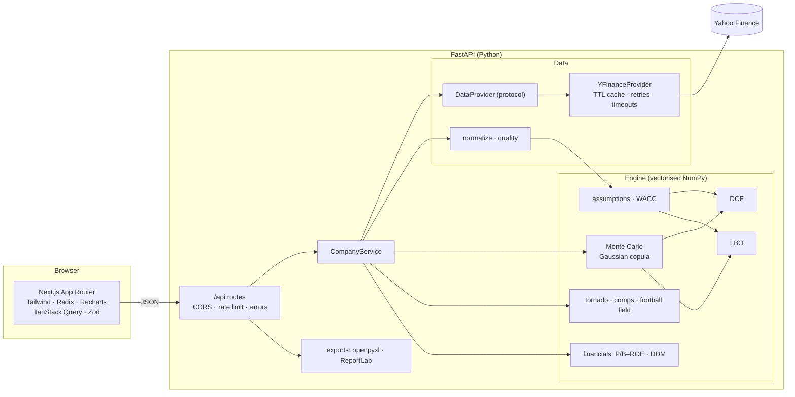

# Rolletto

**Probabilistic DCF and LBO valuation for any public company.** Pick a ticker; Rolletto pulls and cleans five years of financials, derives every assumption (with its source), builds a two-method DCF and a full LBO, then runs 10,000 correlated Monte Carlo simulations through both — returning value distributions, P(undervalued), IRR odds, covenant-breach risk, a tornado chart, trading comps and a football field, exportable to a formula-driven Excel workbook and a one-page PDF memo.

> Educational purposes only — not investment advice. Market data comes from Yahoo Finance via the unofficial `yfinance` library.

## Screenshots

| Home | Workspace | Methodology |
| --- | --- | --- |
| _add `docs/home.png`_ | _add `docs/analyze.png`_ | _add `docs/methodology.png`_ |

## Architecture



```
rolletto/
  backend/            FastAPI app
    app/api/          routes + dependency wiring (rate limiter)
    app/core/         config (country defaults), cache, errors, logging, currency formatting
    app/data/         DataProvider protocol, yfinance implementation, normalisation, data quality, curated peers
    app/engine/       assumptions, wacc, dcf, lbo, montecarlo, distributions, valuation (glue), suitability,
                      classify, financials_valuation, comps
    app/export/       excel.py (live-formula workbook), memo.py (PDF)
    app/schemas/      Pydantic v2 models (the API contract)
    app/services/     orchestration
    tests/            pytest — hand-checked Acme fixture, properties, Monte Carlo, API with mocked provider
  frontend/           Next.js 16 app
    src/app/          routes: /, /analyze, /analyze/[ticker], /methodology, /about, 404, error, sitemap, OG image
    src/components/   ui primitives, layout, analyze workspace + tabs, charts, home, methodology
    src/lib/          typed API client + Zod schemas, formatting (incl. lakh/crore), share-URL codec
  scripts/py.mjs      cross-platform launcher for the backend virtualenv
```

### Key design decisions

- **One engine, every mode.** DCF and LBO are written over NumPy arrays of shape `(n, years)`. The base case is a batch of 1, the Monte Carlo a batch of 10,000, and the tornado a batch of 2k one-at-a-time swings — so all three share identical maths. 10,000 simulations take ~30–60 ms.
- **Correlated sampling** via a Gaussian copula (Cholesky → Φ → inverse CDFs), with PSD validation and a nearest-valid-matrix suggestion on failure.
- **Data honesty.** Missing fields stay missing; every derived figure is recorded; companies whose latest year lacks revenue/EBITDA are refused rather than valued. Banks, insurers, NBFCs, broker-dealers and REITs get P/B–ROE and DDM instead of DCF/LBO.
- **Auditability.** The Excel DCF tab is fully formula-driven from blue input cells and includes a check row against the engine (verified to reconcile exactly in LibreOffice).
- All conventions (mid-year discounting, terminal value timing, capex fade, cash sweep order, IRR formula) are documented in code and on `/methodology`.

## Setup

Prerequisites: **Python 3.11+** and **Node.js 20+**.

```bash
npm run setup
```

That installs the root tooling, the frontend packages, creates `backend/.venv` and installs the Python requirements. Then copy the env examples (all values are optional for local use):

```bash
cp backend/.env.example backend/.env
```

```bash
cp frontend/.env.example frontend/.env.local
```

> If your global pip config points at an unreachable extra index, install with `node scripts/py.mjs -m pip install --isolated -r requirements-dev.txt`.

## Running

```bash
npm run dev
```

Starts the API on <http://localhost:8000> (OpenAPI docs at `/docs`) and the web app on <http://localhost:3000>. Each side can run alone with `npm run dev:backend` / `npm run dev:frontend`; `make dev` etc. are equivalent shortcuts.

## Testing and quality

```bash
npm test
```

Runs the backend suite (65 tests): the hand-checked **Acme** fixture (DCF and LBO verified to the cent, working shown in `tests/fixtures/acme.py`), economic property checks (↑WACC ⇒ ↓value, ↑exit multiple ⇒ ↑IRR, …), Monte Carlo reproducibility, correlation recovery, marginal moments, the 10k-in-under-2-seconds target, and end-to-end API tests with the market-data provider mocked.

```bash
npm run lint
```

Runs ruff, ESLint and a strict TypeScript check. `npm --prefix frontend run format` applies Prettier.

## API

| Method | Path | Purpose |
| --- | --- | --- |
| GET | `/api/health` | Liveness and provider name |
| GET | `/api/search?q=` | Company / ticker autocomplete |
| GET | `/api/company/{ticker}` | Profile, cleaned financials, data quality, classification, suitability, default assumptions (or the financial-company valuation) |
| POST | `/api/valuation` | Ticker + overrides + distributions + correlation + simulation settings → full results |
| POST | `/api/export/excel` | Same body → `.xlsx` |
| POST | `/api/export/memo` | Same body → one-page PDF |

Errors always have the shape `{"error": {"code", "message", "details"}}` (e.g. `ticker_not_found` 404, `invalid_input` / `correlation_not_psd` / `financial_company` 422, `upstream_unavailable` 502, `rate_limited` 429).

## Deployment

**Backend (Render or Railway).** Root directory `backend`, build `pip install -r requirements.txt`, start `uvicorn app.main:app --host 0.0.0.0 --port $PORT`. Set `ROLLETTO_CORS_ORIGINS` to a JSON list containing your frontend URL. The in-memory cache is per instance; one instance is plenty to start.

**Frontend (Vercel).** Root directory `frontend`. Set `NEXT_PUBLIC_API_URL` to the backend URL and `NEXT_PUBLIC_SITE_URL` to the public site URL (used for canonical links, sitemap and Open Graph).

## Known limitations

- **yfinance is unofficial.** Fields can be missing, stale or wrong, and Yahoo rate-limits aggressively; the provider retries with backoff and caches, but a cold request can take a few seconds. Swap in a licensed feed by implementing `DataProvider`.
- **Data gaps.** Some listings (notably smaller Indian companies) have sparse statements; minority interest and non-operating assets are only as good as the reported balance sheet. Everything missing is flagged in the data-quality badge.
- Annual statements only (no TTM); SBC, leases, pensions, NOLs and dilution from options/convertibles are not modelled separately.
- Automatic peers come from Yahoo's industry/sector leaders (curated lists for Indian listings) and are ranked by size — review and edit them in the Comps tab.
- The LBO assumes a single exit and no interim distributions; interest-deductibility caps are ignored.
- Lighthouse (mobile, simulated throttling, local machine): Home and About score 100 for accessibility, best practices and SEO, with performance in the mid-80s to low-90s. Performance is lower on Methodology (~70, long static page) and the analyze workspace (~65, a data-heavy client app that waits on two API calls); accessibility is 100 on both. The analyze page's metadata is streamed; known crawlers receive it in `<head>` by default.

## License

Add your preferred license before publishing.
